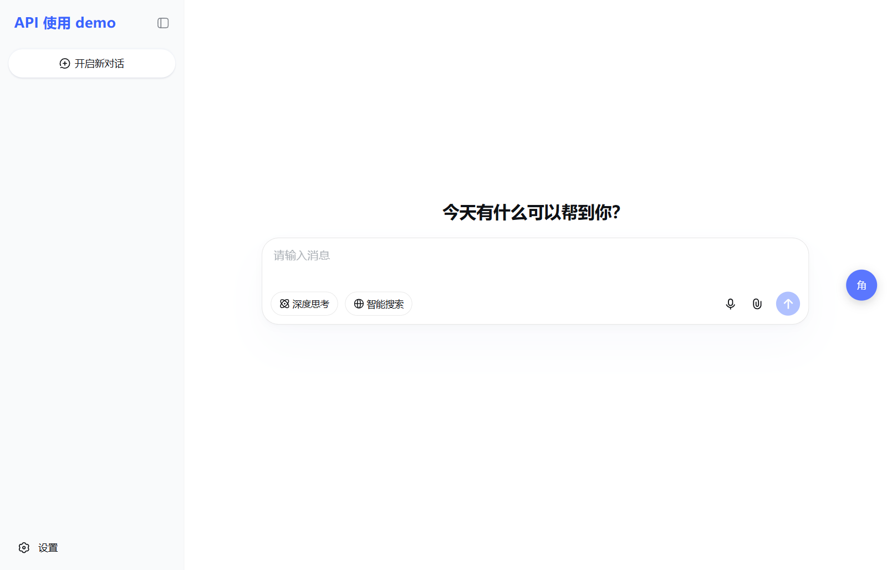
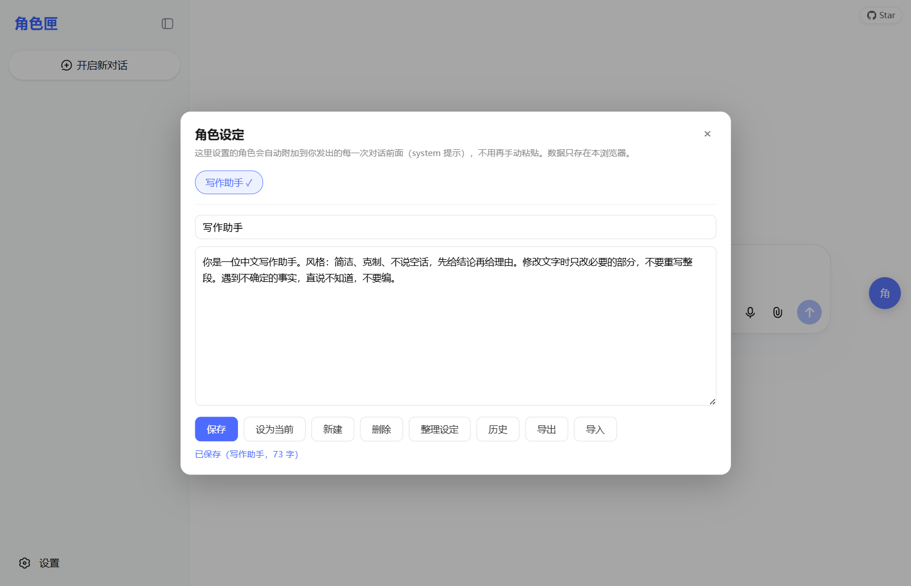

# 角色匣 · RoleBox

[](https://github.com/junyuan-li-liu/rolebox) [](https://github.com/junyuan-li-liu/rolebox/blob/main/LICENSE)

> 给 DeepSeek 官方 [chat-demo](https://github.com/deepseek-ai/chat-demo) 加上「多角色设定」的开源增强版。

**在线试用**：<https://junyuan-li-liu.github.io/rolebox/>

> ⚠️ **非官方项目**：本项目是个人学习作品，基于 DeepSeek 开源的 [chat-demo](https://github.com/deepseek-ai/chat-demo) 二次开发，**与 DeepSeek 官方无关，未获官方授权或背书**。使用本项目产生的 API 费用由使用者自行承担，生成内容的责任亦由使用者承担。



---

## 这是什么

官方 chat-demo 是一个纯前端的 DeepSeek 聊天界面，浏览器直连 API，不经过任何后端。

它有个小遗憾：**没有「角色 / 人设」的概念**。如果你希望 AI 以某个固定身份和你对话（比如一个了解你背景的顾问、一个只说英语的陪练、一个改代码的老师），那就只能在每段对话开头手动粘贴一大段设定——聊新话题时还得再贴一遍。

这个项目在原版基础上加了一层轻量的**角色系统**：

- 设定存一次，之后每次对话自动带上
- 想换身份，切一下就完事
- 数据只在你自己的浏览器里，不上传

## 功能

| 功能 | 说明 |
| --- | --- |
| 多角色管理 | 每个角色 = 名字 + 设定正文，可新建、编辑、删除 |
| 一键切换 | 屏幕右侧「角」按钮打开面板，点一下换成当前角色 |
| 自动注入 | 每次请求自动把当前角色作为 `system` 消息插入，无需手动粘贴 |
| 导出备份 | 导出成 **Markdown（`.md`）**：记事本打开就是正常中文，换行是真换行，没有 `\n` 转义；也兼容旧的 `.json` 备份 |
| 导入（自动分流） | 只有一个「导入」按钮，按扩展名判断：`.json` / `.md` → 整份恢复角色；`.txt` / `.docx` → 当正文读进当前角色 |
| 备份提醒 | 角色只存在浏览器里。距离上次导出超过 7 天，打开页面时提醒一次（可「过几天再说」顺延 3 天） |
| 整理设定 | 聊一阵后点一下，它会说「这段对话里有哪些值得长期记进设定的新东西」，你点「采纳」才写入；写入是**追加**，不动原文，且存历史版本可回滚 |
| 本地存储 | 角色存在浏览器 `localStorage`，不经过服务器 |
| 非侵入 | 只新增 `role-inject.js` 与 `guide.js`，原版代码只动了一处标题文案，随时可摘 |



## 设定会“自己长”——但有你的批准

聊久了，用户难免说出一些本该写进设定的事（“我最近在准备专升本”“别叫我老师”）。人自己会记住，设定不会。

所以做了「整理设定」：点「角」→「整理设定」→ 设好取最近几轮（默认 20）→「开始整理」。它会**另发一次请求**（不是在你正常聊天里夹私货），让模型回答一个问题：这段对话里有没有值得长期记住的新信息？

有的话给你一条建议，附上依据，比如：

> 💡 建议补充到「观澜」的设定里
> + 钧渊最近在准备专升本，压力较大
> 依据：用户明确陈述自己正在准备专升本，属于长期学业目标
> [采纳] [忽略]

**建议那几行是可以直接改的**——它写得啰嗦、或者理解偏了，你就在框里删改，改完点「采纳」，写进去的是你改后的版本，不是它原话。

**几个刻意的设计：**

- **不自动改**。它只提议，你不点「采纳」就什么都不会变。
- **只追加，不覆盖**。采纳后写进正文末尾，带日期标记：`<!-- 以下为后续补充（2026-11-18） -->`，你原来写的一个字不动，觉得多事就整段删。
- **可回滚**。每次写入前存一份历史版本（每个角色最多 10 份），点「历史」可以回退。
- **不想要就关掉**。同一个面板里取消勾选「启用这个功能」，按钮会变成「整理设定（已关）」——仍然留着入口，免得关了以后再也找不到。
- **失败不改东西**。网络错、返回不是合法 JSON、没有新信息，都只提示，不写入。

费用上，一次整理大概几分钱（20 轮对话约 3000–5000 token）。它只在你点的时候发生，不会默默烧钱。

## 用角色卡，和每次手动粘贴设定有什么不同

原版 chat-demo 也能"给 AI 一个身份"——把设定写在第一条消息里发出去。但这么做有两个问题：

1. **越聊越忘**：设定躺在对话历史的开头，对话一长，早期消息会被截断或压缩，设定就淡出甚至消失了。表现为聊到后面它"不记得自己是谁"。
2. **每开一个新对话都要重新贴一遍**。

角色卡不一样：它存在浏览器的 `localStorage` 里，每次发消息时被**注入到本次请求的最前面**（`system` 角色），不依赖对话历史。所以只要还在同一个上下文窗口内，这个设定**每一轮都会重新发给模型**，不会因为聊久了而消失。

**但要说清楚限度**：这不等于"无限记忆"。总长度仍受模型上下文窗口限制——设定越长，留给对话的空间越小；对话特别长时，被截断的会是**对话历史**，而不是设定。真需要长期记住大量资料（几十页文档），得靠检索（RAG），本项目没做。

## 快速开始

1. 打开 <https://junyuan-li-liu.github.io/rolebox/>
2. 点左下 **设置 → 数据管理**，填入你的 [DeepSeek API Key](https://platform.deepseek.com/api_keys)
3. 点屏幕右侧的 **「角」** 按钮 → **新建** → 填角色名字和设定正文 → **保存**
4. 关掉面板，直接开始聊天，设定已经自动带上了

> **手机上用**：浏览器打开同一个网址，菜单里选「添加到主屏幕」，用起来和 App 差不多。

## 关于 API Key 与费用

- 这是**前端直连**：你的 Key 只保存在你自己浏览器的 `localStorage` 里，不会发给任何第三方
- 聊天按 **token 计费**，直接从你的 DeepSeek 账户扣，和官方 App 一样
- 换设备、换浏览器、清缓存，都需要重新填一次 Key（角色设定同理）

## 自己部署一份

1. Fork 这个仓库
2. 仓库 **Settings → Pages** → Source 选 `Deploy from a branch`，分支 `main`，目录 `/ (root)`
3. 等一两分钟，访问 `https://<你的用户名>.github.io/rolebox/`

也可以用 Vercel、Cloudflare Pages 等任意静态托管，把仓库文件直接传上去即可（无需构建）。

## 已知限制

说清楚，免得你用了才发现：

- **角色是「全局切换」，不是「每个对话单独绑定」**。你在「角」面板里换成谁，之后所有对话都用这个角色。想同时开三路（一个顾问、一个陪练、一个老师）目前做不到，得来回切。
- **角色数据存在浏览器里**，清缓存/换设备就没了。请用面板里的「导出」存一份 Markdown；页面也会在你超过 7 天没导出时提醒。
- **导入文档只支持 `.txt` / `.md` / `.docx`**，不支持 PDF（中文 PDF 多为扫描件，抽不出可靠文字；请先另存为文本）。另外正文超过 15000 字会被拒绝——它每轮都要完整重发，太长既费钱又挤占上下文。
- 只测过 Edge / Chrome 内核浏览器，Safari 未验证。

## 技术实现

整个增强只有两个文件，原版打包产物只改了一个标题字符串：

- **`role-inject.js`**（约 35 KB，零依赖，原生 JS）
  - 包装 `window.fetch` 与 `XMLHttpRequest.prototype.send`
  - 检测请求体里是否有 `messages` 数组；有的话，把当前角色以 `{role: 'system', content: ...}` 插到最前面
  - 带 `_dshRole` 标记，避免重复注入
  - 不依赖具体接口地址，因此原版换端点也不会失效
  - 自己实现 zip 解析（`DecompressionStream('deflate-raw')`）读 `.docx`，不引第三方库
- **`guide.js`**：首次访问的三步引导
- **`index.html`** 里只多了两行 `<script defer src="...">`

角色数据：

```js
localStorage['dsh_roles_v1']         // [{ id, name, content }]
localStorage['dsh_active_role_v1']   // 当前角色 id
localStorage['dsh_role_history_v1']  // 整理设定的历史版本（每角色 10 份）
localStorage['dsh_recent_msgs_v1']   // 最近 60 条消息（供「整理设定」分析）
localStorage['dsh_last_export_v1']   // 上次导出时间（备份提醒用）
```

## 已踩过的坑

- **改了脚本但界面没变化** → 浏览器缓存，`Ctrl + Shift + R` 强制刷新（维护者改动后记得给 `index.html` 里的脚本地址加 `?v=N`）
- **角色不生效** → 确认「角」面板里那个角色后面有 ✓（表示是当前角色）
- **数据丢了** → 浏览器清过缓存；角色是本地数据，不会自动备份
- **导出的文件在记事本里乱码** → 早期版本导出的是无 BOM 的 UTF-8，Windows 记事本会当 GBK 打开。现已改为 Markdown + BOM，旧 `.json` 备份也能正常导入

## 致谢与许可

- 前端来自 [deepseek-ai/chat-demo](https://github.com/deepseek-ai/chat-demo)，本仓库在其 v0.1.1 基础上二次开发
- 原项目为 MIT 协议，`LICENSE` 文件保留原样（Copyright © 2026 DeepSeek）
- 本项目新增部分（`role-inject.js`、`guide.js`、文档）同样以 MIT 协议提供，可自由使用与修改

## 免责声明

本项目是个人学习与自用性质的开源项目，与深度求索（DeepSeek）官方无关。使用产生的 API 费用由使用者自行承担。
